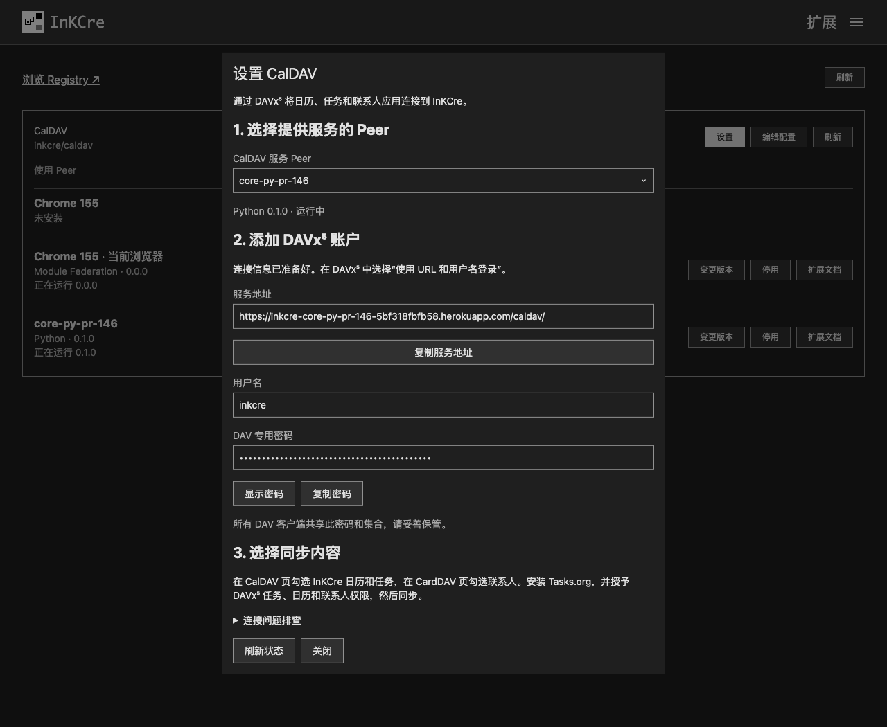
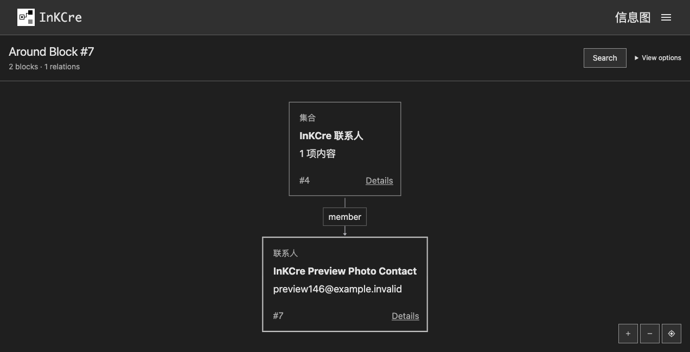
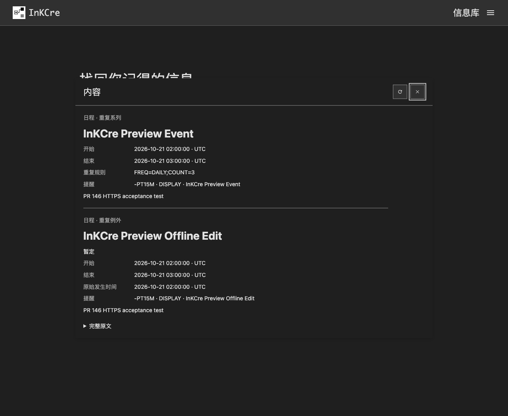
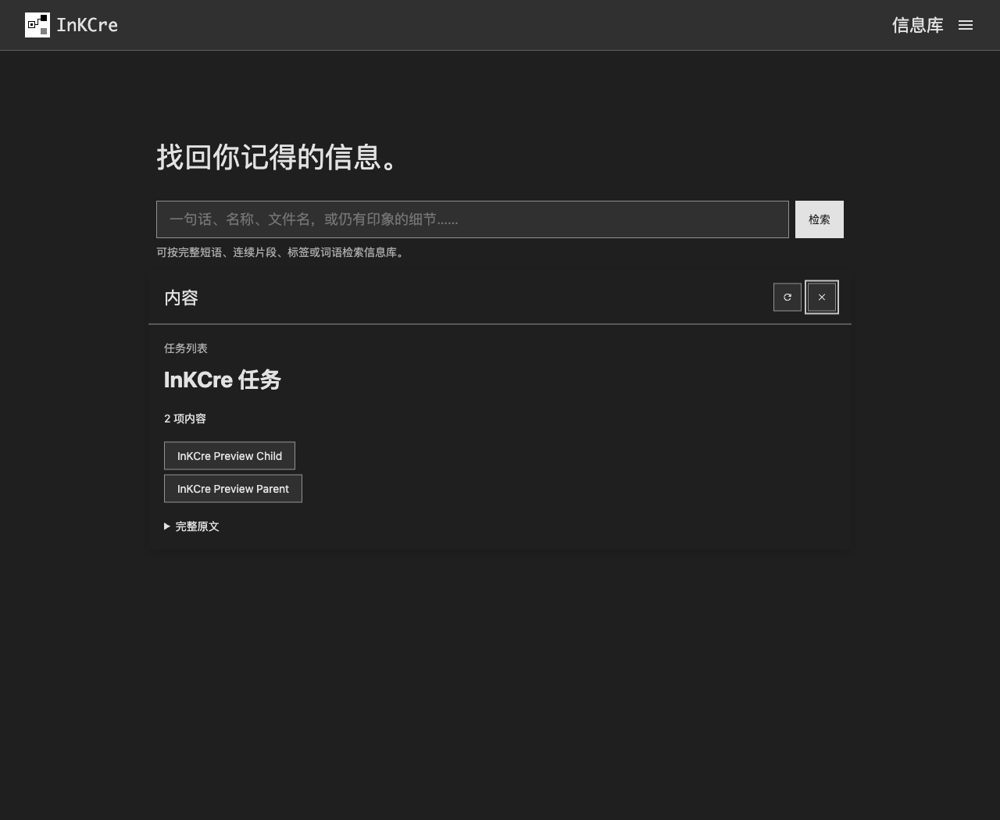
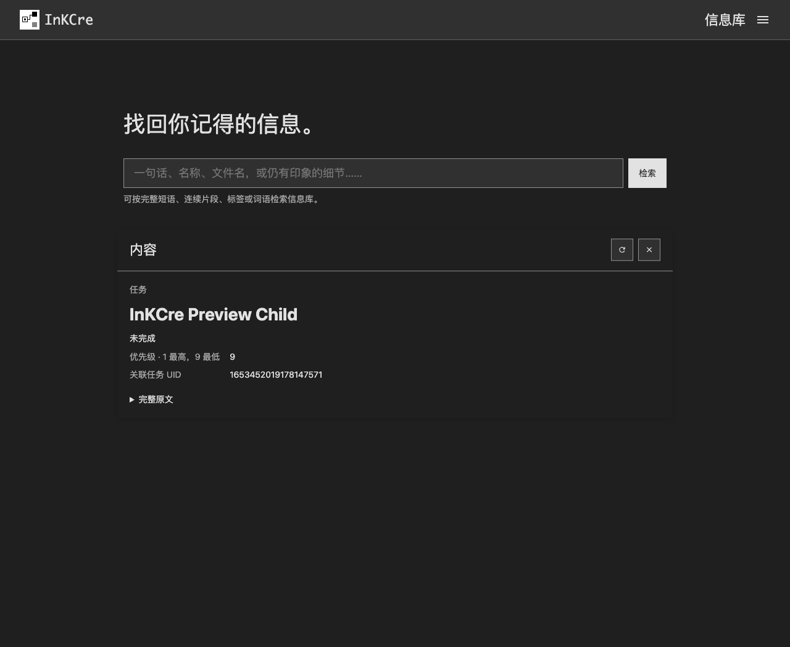
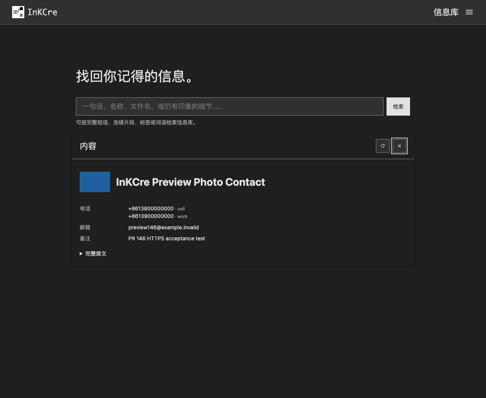
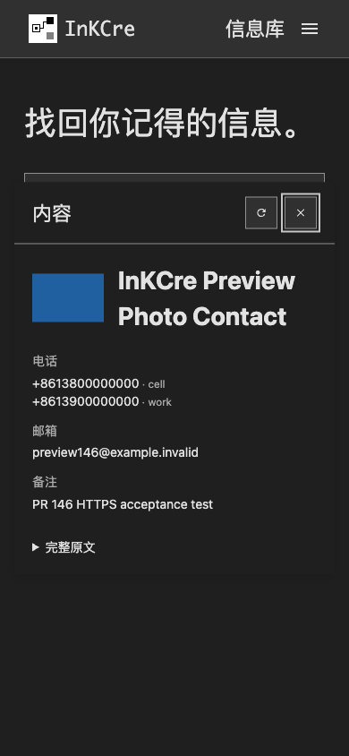

# CalDAV Web 扩展

在当前浏览器安装并启用 `inkcre/caldav` 的 Module Federation 分发，然后在扩展卡片中
点击「设置」打开连接向导。Web 分发提供连接准备和内容阅读；持续接收手机同步的能力由运行 Python
分发的 Peer 提供。两种分发共享同一份扩展配置与信息。

## 准备手机连接

向导列出能够管理 Python 扩展的在线 Peer。选中提供服务的 Peer，点击「准备连接」。
如果该 Peer 尚未选择 CalDAV，向导从它自己的 Registry 选择可用发行版；已有版本保持不变。
首次安装需要该 Peer 的 Registry 地址或共享部署 Registry 配置。若地址仅保存在 Python
进程环境中，Web 无法读取它；按向导提示在「Peer → 编辑配置」中明确填写一次。
首次安装可能重启 Peer，看到安装或重启提示后点击「刷新状态」，待操作结束再继续准备连接。
打开向导、切换 Peer 和刷新只读取状态，不会生成密码或启用服务。
下载、安装和重启期间不能重复准备连接；如果安装失败，请先在扩展卡片中检查并恢复
对应 Peer，再刷新向导。失败时的待重启标志不代表 Peer 会自动恢复。

已有专用密码会继续使用；尚未配置时才生成随机密码并保存。连接准备完成要求所选 Peer
实际运行了选定版本，并成功返回连接地址。保存成功但响应丢失时，向导要求先刷新确认结果，
不会自动重复写入或换一个 Peer 重试。

在 DAVx⁵ 中选择「使用 URL 和用户名登录」，填写向导显示的完整服务地址、`inkcre`
用户名和 DAV 专用密码。密码默认遮蔽，可以主动显示或复制。随后在 CalDAV 页选择日历和
任务，在 CardDAV 页选择联系人；任务同步还需要安装 Tasks.org 并授予 DAVx⁵ 任务权限。
手机必须能够访问服务地址；向导读到地址不代表已验证手机网络。

窄屏可上下滚动查看同一向导：[390px 窄屏截图](images/web-setup-mobile.png)。

如果服务已运行但无法提供连接地址，在「Peer → 编辑配置」设置该 Peer 的公共 HTTP
基址，再刷新向导。手机端后续操作见
[DAVx⁵、Tasks.org 和联系人教程](https://github.com/InKCre/impl-py/blob/feat/caldav-extension/extensions/caldav/docs/global/android.md)。

所有 DAV 客户端共享密码和集合。准备连接不会轮换已有密码；如需撤销或轮换，使用所选
Python 分发的配置表单修改 `password`，并更新仍需同步的客户端。

## 阅读同步内容

信息库的预览用于辨认对象，打开内容后可以阅读完整事件、任务、联系人和集合成员。
图中的集合和联系人卡片会显示名称、类型与摘要，成员关系仍来自同一信息库。

日历资源中的主事件与每个重复例外分别展示；没有把重复系列展开成未来日程表。
日期类型保持全天语义，全天结束日期标明不包含该日。时间显示保存的墙上时间与原始
TZID／UTC，未指定时区的时间会明确标注，不按浏览器时区隐式换算。
排除日期与补充日期保留原生属性中的时区和日期类型参数。

任务显示完成状态、到期、提醒与关联任务 UID；解析到同集合的父任务后，可以从「关联内容」直接打开父任务。联系人显示多个电话、邮箱、地址、备注
和嵌入式照片；外部照片地址需要主动打开，不在阅读时自动访问第三方。「DAV 内容」由当前根和关联内容组合，包含未单独展示的扩展字段；无法解析的记录会显示错误。

「关联内容」提供电话、邮箱、备注、媒体和关联任务的入口。点击照片可用通用图片视图打开独立图片 Block；这些内容可以在信息库其他位置引用，修改后会进入下一次手机同步。旧格式记录仍可阅读，运行 Python 0.2.0 后会原地升级并保留对象 ID。

打开集合后，点击成员名称进入对应内容。以下任务集合与父子关系来自 Tasks.org 的真实同步。

窄屏也可以阅读联系人和全天事件。全天结束日期 `2026-10-21` 表示此事件只覆盖
`2026-10-20`，没有延长到第二天。

| 联系人                                       | 全天事件                                       |
| -------------------------------------------- | ---------------------------------------------- |
|  |  |

这些视图只读取共享 Blocks 与成员 Relations，不写回简化模型。手机同步更新后，使用宿主
的信息库刷新操作取得新内容。停用 Web 分发会卸载对应渲染能力，不会删除 DAV 内容或
停止其他 Peer 上运行的 Python 分发。

本文截图使用 Web PR #142 与 Python PR #146 的 preview 和专用测试数据。浏览器通过本机
限定 preview 域名的 CONNECT 转发访问服务，HTTPS 证书校验保持启用；这一网络条件不属于
插件部署要求。手机同步沿用 Python 教程中记录的 USB 转发条件。
